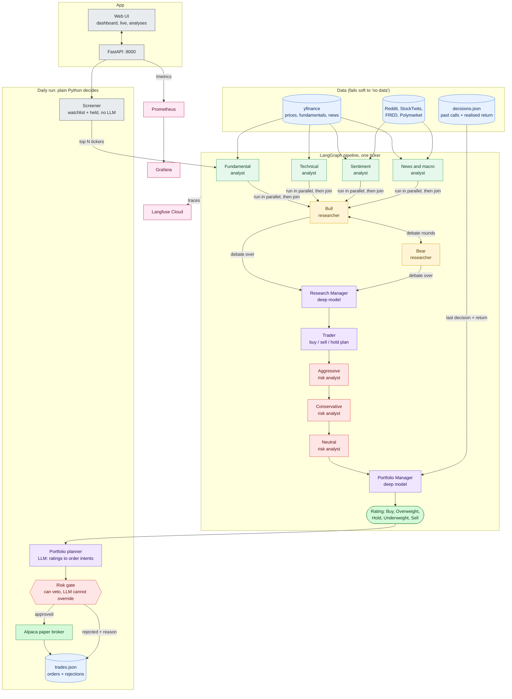

# trading-agents

Four analysts (fundamental, technical, sentiment, news) study a stock, bull and bear researchers debate it, a trader and a three-way risk panel refine the plan, and a portfolio manager issues a Buy to Sell rating. An autonomous loop then screens a watchlist, sizes positions and sends orders to an Alpaca **paper** account, with a terminal-styled web UI, Prometheus/Grafana metrics and Langfuse traces.

**The LLM proposes; plain Python decides:** a rule-based risk gate can veto any order, and the LLM cannot override it. Paper trading only. Not financial advice.


## How it works



## Features
- 4 analysts, Bull/Bear debate, Research Manager, Trader, 3-way risk debate, Portfolio Manager; 5-tier rating (Buy / Overweight / Hold / Underweight / Sell).
- Structured (Pydantic) output from every agent.
- Decision log with reflection: the next run on a ticker sees the realised return of the last call.
- Autonomous paper portfolio: screen, analyse, plan, risk gate, execute, log. Dry run by default; orders need `--execute`.
- Risk gate: 10% max per stock, 10% cash floor, 5 positions, mandatory stop-loss, halt after a 10% drawdown from peak. Sells always pass.
- Optional weekday 16:30 ET schedule, and an equity-vs-SPY report (`python -m trading.report`).

## UI
A terminal-styled web app served by the API (plain HTML/JS, no build step). Tabs (keys `1`-`6`, `/` focuses the ticker search in the header):
- **dashboard**: equity, cash, P&L, drawdown, countdown to the next daily run, equity curve, allocation, positions.
- **live**: the pipeline stage by stage with each agent's output as it finishes, a log, and a box to **queue an analysis** of any listed US stock (at most 3 waiting at once, one per visitor; when full it says who is ahead).
- **analyses**: every finished analysis (search by ticker or rating); open one to read each agent's output and reasoning.
- **daily runs**: each cycle's candidates and why they were picked, the planner's stance (enter new / maintain / rebalance / do nothing), approved and rejected orders with the risk-gate reason.
- **market**: 1y price chart with SMA 50/200 and Bollinger bands (our past calls marked), RSI, fundamentals, news.
- **flow**: an interactive map of how data and decisions move between the agents (click a box; "walk through" steps it; running agents glow).

The public UI is read-only apart from that queue: nothing can start a daily cycle, trade, or change the account. An owner page at `/admin` (password in `ADMIN_PASSWORD`, not linked anywhere) can add cash to the simulated account, sell positions and queue a daily cycle.

## Automation
`ENABLE_SCHEDULER=1` runs the daily cycle on weekdays at `DAILY_AT` (default 16:30 New York): the screener picks the stocks we hold plus the top `DAILY_CANDIDATES` watchlist movers, each gets the full pipeline (`DEBATE_ROUNDS` bull/bear rounds), then the planner decides whether to enter new positions, keep what we hold, rebalance or do nothing, and the rule-based risk gate vetoes anything unsafe. With `SCHEDULER_EXECUTE=1` approved orders trade the **simulated** account (`PORTFOLIO_MODE=sim`, persistent, $100k start; `alpaca` is still available). If the server was down past the scheduled time and no cycle ran that day, one is queued on start-up. All jobs share one worker, so a cycle and visitor requests run one after another.

## Local model (no API key)
`core/.env` can point at an open-source model served by Ollama instead of Gemini/Groq. Ollama is **not** part of this stack: it runs on its own, forever, as a container named `ollama` (here on an Oracle ARM VM, 2 cores / 12 GB).
```bash
# on the VM, once
docker network create llm
docker run -d --name ollama --restart unless-stopped --network llm -p 127.0.0.1:11434:11434 -v ollama:/root/.ollama \
  -e OLLAMA_NUM_PARALLEL=1 -e OLLAMA_CONTEXT_LENGTH=8192 -e OLLAMA_KEEP_ALIVE=-1 --memory 7g ollama/ollama
docker exec ollama ollama pull qwen3:4b-instruct-2507-q4_K_M
```
```
LLM_MODEL="ollama_chat/qwen3:4b-instruct-2507-q4_K_M"
LLM_MODE=json_schema      # grammar-constrained JSON; tools mode is unreliable on small models
LLM_TIMEOUT=900  LLM_MAX_TOKENS=700  LLM_RPM=0  LLM_DATA_CHARS=1200  PRICE_DAYS=4  LLM_CLIP_SCALE=0.5
```
The connection is just `OLLAMA_API_BASE`: on the VM the api joins the `llm` network and uses `http://ollama:11434`; from a laptop use `ssh -fN -L 11434:127.0.0.1:11434 oracle-vm` and `http://localhost:11434` (`start.sh` does this). Small local models are told to keep text short (`LLM_BRIEF=0` turns that off). Expect 25-40 minutes per analysis on 2 CPU cores.

## Run on a server
```bash
./deploy.sh            # rsync + docker compose up on the VM (API + web UI + scheduler + Prometheus + Grafana); needs the `ollama` container above
./deploy.sh public     # Caddy sites: https://trading-agents.samirkhairati.me (A record -> the VM) and https://grafana.<ip>.sslip.io (anonymous viewers)
./deploy.sh tunnel     # server UI/Grafana on localhost:8000 / :3001
./deploy.sh logs | status | down
```
Everything that must outlive a deployment (analyses, decision log, trades, the simulated account) is in the Docker volume `trading-agents_state`; deploying, restarting or `down` never touches it (`down -v` would). The Grafana admin password is `GRAFANA_ADMIN_PASSWORD` in `~/trading-agents/.env` on the server.

### CI/CD (GitHub Actions -> GHCR -> server)
`.github/workflows/deploy.yml`: pull requests run the tests; pushes to `main` also build a multi-arch image, push it to `ghcr.io/samirkhairati/trading-agents` (`latest` + commit sha) and deploy it by SSH (`docker compose pull api && up -d`). Repository secrets: `DEPLOY_HOST`, `DEPLOY_USER`, `DEPLOY_SSH_KEY` (a private key whose public half is in the server's `authorized_keys`). `core/.env` stays on the server; the workflow never touches it.

## Built with
Python 3.11, LangGraph, instructor + LiteLLM (Gemini, Groq or a local Ollama model), FastAPI, yfinance, Alpaca (`alpaca-py`, paper), a vanilla JS web UI, Docker Compose, GitHub Actions + GHCR, Prometheus, Grafana, OpenTelemetry, Langfuse.

## Observability
- **Traces** (Langfuse Cloud, free tier): one trace per analysis, a span per agent, prompts and replies. Set `LANGFUSE_*` in `core/.env`; `TRACE_CONTENT=0` hides the text.
- **Metrics**: the API serves `/metrics` (LLM calls, tokens, rate limits, node timings, portfolio, orders). Prometheus scrapes it; Grafana has a "Trading Agents" dashboard; alerts live in `observability/prometheus/alerts.yml`.

| Service    | URL                   | Login                    |
|------------|-----------------------|--------------------------|
| API        | http://localhost:8000 | none                     |
| Grafana    | http://localhost:3001 | admin / admin-local-pass |
| Prometheus | http://localhost:9090 | none                     |

## Run
Copy `core/.env.example` to `core/.env` and add `GEMINI_API_KEY` (or Groq), plus optional `ALPACA_API_KEY` / `ALPACA_SECRET_KEY` (paper) and `LANGFUSE_*`. Without Alpaca keys a fake $100k account is used.

```bash
./start.sh                                   # SSH tunnel (if local model) + everything in Docker, opens the web UI; Ctrl+C stops all
docker compose up -d --build                 # background stack only

# other features
docker compose run --rm api python run.py AAPL                              # analyse one stock
docker compose run --rm api python -m trading.daily_run --tickers AAPL      # dry run
docker compose run --rm api python -m trading.daily_run --tickers AAPL --execute   # sends PAPER orders
ENABLE_SCHEDULER=1 docker compose up -d      # daily cycle inside the API (dry run unless SCHEDULER_EXECUTE=1)
docker compose down                          # stop
```

Without Docker: `cd core && python3.11 -m venv venv && venv/bin/pip install -r requirements.txt`, then `venv/bin/python run.py AAPL`, or `venv/bin/uvicorn main:app --port 8000` for the API and web UI (`ENABLE_SCHEDULER=1` adds the daily schedule).

## Test
`cd core && venv/bin/python -m pytest -q` (no network, no API key).
