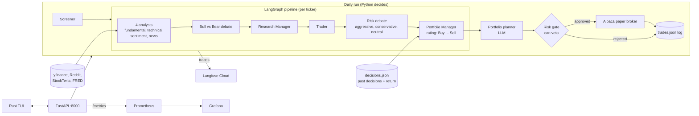

# SimpleTradingAgents

A small, runnable model of [TradingAgents](TradingAgents/): a team of LLM agents analyses a stock, and a paper-trading portfolio manager acts on the result. **The LLM proposes; plain Python decides.** Paper trading only. Not financial advice.

## How it works



## Features
- 4 analysts, Bull/Bear debate, Research Manager, Trader, 3-way risk debate, Portfolio Manager; 5-tier rating (Buy / Overweight / Hold / Underweight / Sell).
- Structured (Pydantic) output from every agent.
- Decision log with reflection: the next run on a ticker sees the realised return of the last call.
- Autonomous paper portfolio: screen, analyse, plan, risk gate, execute, log. Dry run by default; orders need `--execute`.
- Risk gate: 10% max per stock, 10% cash floor, 5 positions, mandatory stop-loss, halt after a 10% drawdown from peak. Sells always pass.
- Optional weekday 16:30 ET schedule, and an equity-vs-SPY report (`python -m trading.report`).

## UI
Rust terminal app (ratatui). Keys: `a` Analyze (ticker input, live stage progress, coloured rating, reports, debates), `p` Portfolio (equity, positions, trades, trigger dry/execute runs), `q` quit. The raw-data tabs show prices, fundamentals and news.

## Built with
Python 3.11, LangGraph, instructor + LiteLLM (Gemini or Groq), FastAPI, yfinance, Alpaca (`alpaca-py`, paper), Rust + ratatui, Docker Compose, Prometheus, Grafana, OpenTelemetry, Langfuse.

## Observability
- **Traces** (Langfuse Cloud, free tier): one trace per analysis, a span per agent, prompts and replies. Set `LANGFUSE_*` in `core/.env`; `TRACE_CONTENT=0` hides the text.
- **Metrics**: the API serves `/metrics` (LLM calls, tokens, rate limits, node timings, portfolio, orders). Prometheus scrapes it; Grafana has a "Trading Agents" dashboard; alerts live in `observability/prometheus/alerts.yml`.

| Service    | URL                   | Login                    |
|------------|-----------------------|--------------------------|
| API        | http://localhost:8000 | none                     |
| Grafana    | http://localhost:3001 | admin / admin-local-pass |
| Prometheus | http://localhost:9090 | none                     |

## Run
Copy `core/.env.example` to `core/.env` and add `GEMINI_API_KEY` (or Groq), plus optional `ALPACA_API_KEY` / `ALPACA_SECRET_KEY` (paper) and `LANGFUSE_*`. Without Alpaca keys a fake $100k account is used.

```bash
./start.sh                                   # everything in Docker + the TUI; stops all on quit
docker compose up -d --build                 # background stack only
docker compose run --rm tui                  # TUI against a running stack
docker compose run --rm api python run.py AAPL                              # analyse one stock
docker compose run --rm api python -m trading.daily_run --tickers AAPL      # dry run
docker compose run --rm api python -m trading.daily_run --tickers AAPL --execute   # sends PAPER orders
ENABLE_SCHEDULER=1 docker compose up -d      # daily cycle inside the API (dry run unless SCHEDULER_EXECUTE=1)
docker compose down                          # stop
```

Without Docker: `cd core && python3.11 -m venv venv && venv/bin/pip install -r requirements.txt`, then `venv/bin/python run.py AAPL`, or `cargo run` in `tui/` with the API on 127.0.0.1:8000.

## Test
`cd core && venv/bin/python -m pytest -q` (no network, no API key).

## Notes
Free Gemini is about 20 requests/day per model; a run costs ~10 calls per ticker (`LLM_RPM` throttles). Groq free tier works with the gpt-oss models and `LLM_TPM=7000`. Paper results over a few weeks prove little.
